# 02 · Screens and interactions

Quoted text is the exact wording in the app. *Placeholders* like `{name}` are filled at runtime.
Screenshots are dark mode, taken on the iPhone 17 simulator with sample data for a sample baby named "Milu".

## App structure

```
First launch ─► Onboarding (4 steps) ─► Tabs
                                         ├─ Today       (Settings sheet, Vaccinations sheet, Log sheet, Add sheet)
                                         ├─ History     (Edit entry sheet, Go-to-day sheet, Share menu)
                                         └─ Care Plan   (Add/Edit item sheet, Vaccinations page)
```

- 3 tabs at the bottom: **Today** (sun-horizon icon), **History** (clock-arrow), **Care Plan** (clipboard).
- A **toast** appears above the tab bar after most actions and stays 5 seconds. Some toasts have an **Undo** button, and tapping a toast dismisses it.
- Every screen sits on the same soft gradient background with blurred color blobs (see [03](03-design-system.md)).
- Cards are translucent "glass" panels.

---

## 1. Onboarding

A progress indicator of 4 dots sits at the top. The current dot is a wider pill. Each step slides in from the right. The buttons sit in a footer at the bottom.

### 1a. Welcome

<p>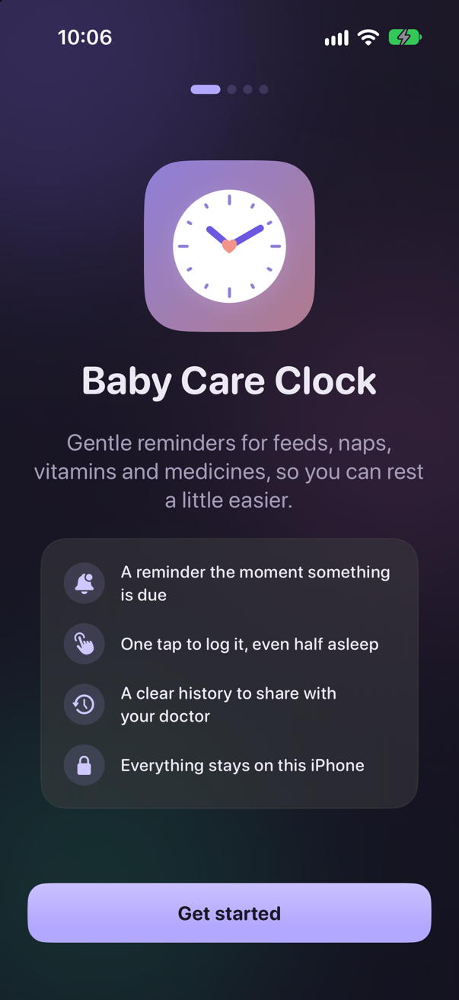 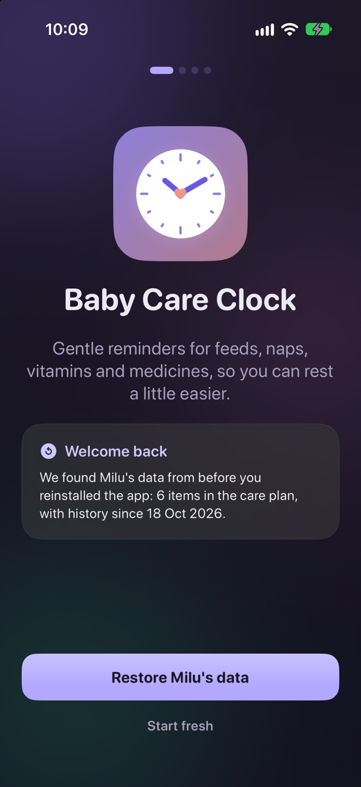</p>
- App mark: a drawn clock face with a heart, 150 pt.
- Title "Baby Care Clock". Subtitle "Gentle reminders for feeds, naps, vitamins and medicines, so you can rest a little easier."
- Feature card with 4 rows (icon in a soft circle):
  - "A reminder the moment something is due"
  - "One tap to log it, even half asleep"
  - "A clear history to share with your doctor"
  - "Everything stays on this iPhone"
- Button: **Get started**.
- **Reinstall variant:** if a backup is found, the feature card is replaced by a "Welcome back" card: "We found {name}'s data from before you reinstalled the app: {N items} in the care plan, with history since {date}."
  - Buttons: **Restore {name}'s data** (primary) and **Start fresh** (text).
  - Start fresh asks for confirmation: "Start fresh?" / "Delete old data and start fresh" / "The data from before can't be brought back afterwards."
  - After a restore, the toast says "Welcome back! {name}'s data is restored", and the notification permission is asked for again.

### 1b. Baby

<p>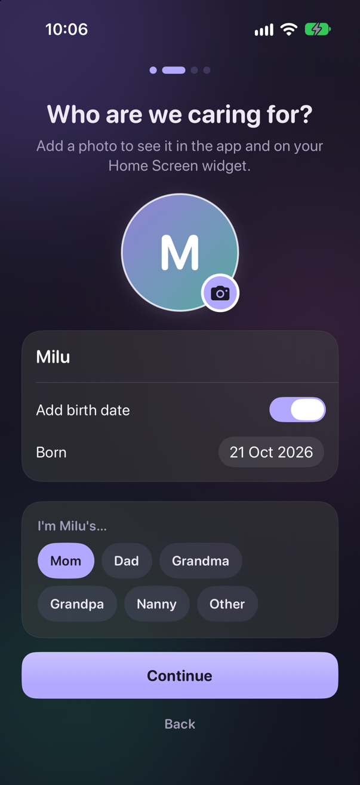</p>
- Title "Who are we caring for?" Subtitle "Add a photo to see it in the app and on your Home Screen widget."
- Round avatar, 130 pt, with a camera badge (a pencil once a photo is set). It opens the photo picker.
- Card:
  - "Baby's name" text field (focused automatically)
  - Toggle "Add birth date" (on by default) and a "Born" date picker (up to 5 years back, no future dates)
- Card: **caregiver role picker**. Label "I'm {name}'s…" with chips: Mom · Dad · Grandma · Grandpa · Nanny · Other. "Other" shows a text field with the placeholder "e.g. Aunt, Amma, Papa".
- Footnote "Only stored on this iPhone. Never uploaded."
- **Continue** stays disabled until a name is entered. **Back** is a text button.

### 1c. What to track

<p>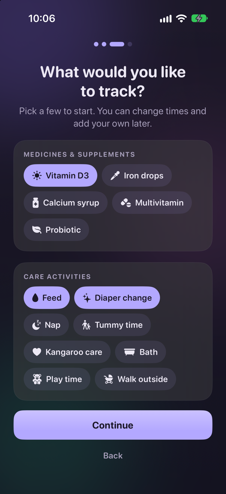</p>
- Title "What would you like to track?" Subtitle "Pick a few to start. You can change times and add your own later."
- Two cards of toggle chips (icon and name):
  - MEDICINES & SUPPLEMENTS: Vitamin D3, Iron drops, Calcium syrup, Multivitamin, Probiotic
  - CARE ACTIVITIES: Feed, Diaper change, Nap, Tummy time, Kangaroo care, Bath, Play time, Walk outside
- Selected by default: **Feed, Diaper change, Vitamin D3**.
- Footnote "Each one starts counting from now. Feeds and diapers repeat every 3 hours, vitamins once a day."
- The button reads **Continue**, or **Skip for now** if nothing is selected.
- Each chosen template becomes an *Interval* item, first due at **now + its interval** (see the template table in [04](04-data-model.md)).

### 1d. Reminders

<p>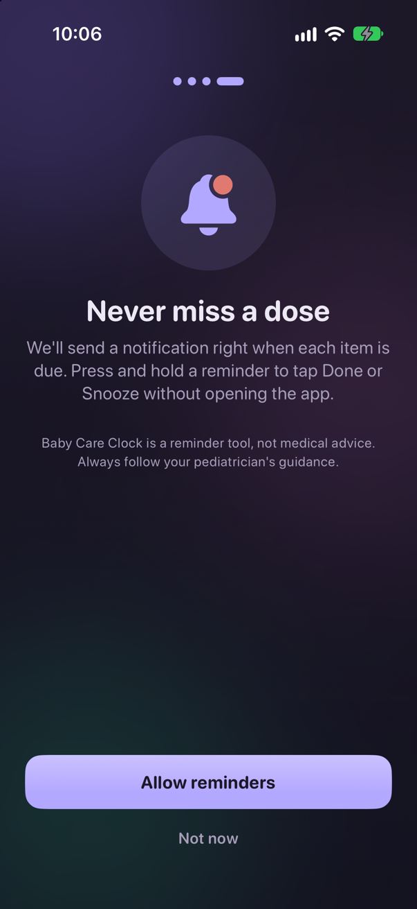</p>
- Big bell icon. Title "Never miss a dose". Subtitle "We'll send a notification right when each item is due. Press and hold a reminder to tap Done or Snooze without opening the app."
- Disclaimer "Baby Care Clock is a reminder tool, not medical advice. Always follow your pediatrician's guidance."
- **Allow reminders** shows the system permission prompt, then enters the app. **Not now** enters the app without asking.

---

## 2. Today

<p>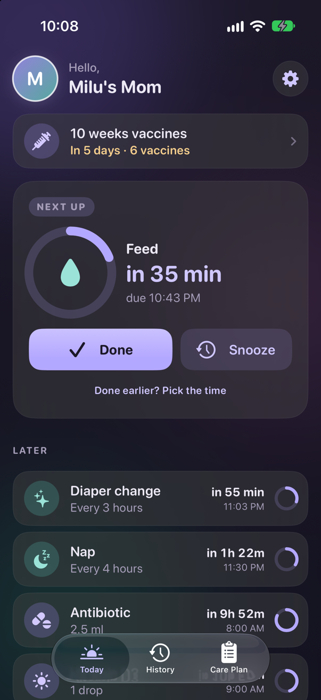 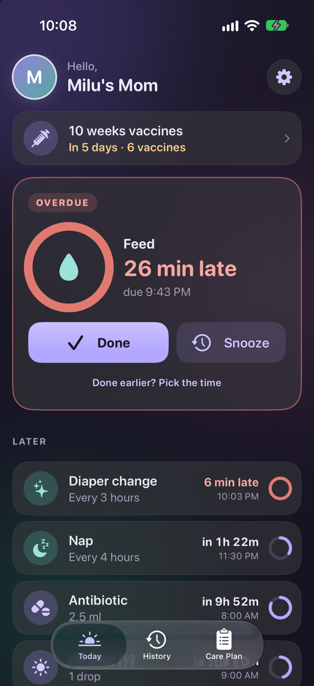</p>

The screen refreshes every 15 seconds, so countdowns tick down.

From top to bottom:

1. **Header:** avatar (56 pt) · a small grey line `{greeting},` · a bold line with the caregiver title ("Vedika's Dad"), or the baby's name if no role is set · a gear button that opens Settings.
   - Greeting by hour: 5–11 "Good morning", 12–16 "Good afternoon", 17–21 "Good evening", 22–4 "Hello".
   - Names ending in "s" get `s'` ("Dhruvs' Mom").
2. **Vaccine banner** (only when the next visit is *due soon* (≤ 7 days) or *overdue*): syringe icon, "{visit} vaccines", "{Due today / In 3 days / 2 days overdue} · {6 vaccines}" in amber (red if overdue). Tapping it opens Vaccinations as a sheet.
3. **Hero card ("Next up")**, the most urgent scheduled item:
   - Status pill: **NEXT UP** (purple) / **DUE SOON** (amber) / **OVERDUE** (coral). An overdue card also gets a coral outline.
   - A 104 pt **countdown ring** that drains as the due time approaches, with the item's icon in the middle. An overdue ring is full and coral.
   - Item name (large) · countdown "in 1h 10m" / "Due now" / "12 min late" · detail line "{dosage} · due 2:30 PM" (or "tomorrow 8:00 AM", "yesterday …", "Mon 9:00 AM").
   - Buttons: **Done** (primary, full width) and **Snooze** (soft, at most 140 pt wide).
   - Text link "Done earlier? Pick the time" opens the Log sheet.
4. **LATER** heading, then one row per other scheduled item: icon badge · name · second line (the dosage, or the schedule text "Every 3 hours") · on the right "in 2h" / "5 min late" plus the time · a small ring. Tapping a row opens the Log sheet.
5. **AS NEEDED** heading, then rows: icon · name · "Last given 3h 10m ago" (or "Not given yet") · on the right, either green "✓ OK to give" or amber "Wait until / 5:06 PM". Tapping opens the Log sheet.
6. Footer hint "Tap to log · swipe for snooze or skip".
7. **Empty state** (nothing in the plan): "Nothing to track yet" / "Add feeds, naps, vitamins or anything else, and we'll remind you when each one is due." / button **Add to care plan**, which opens the Add sheet.

**Gestures on the hero card and Later rows**

| Gesture | Result |
|---|---|
| Swipe right (full swipe allowed) | **Done** (green) |
| Swipe left | **Skip** (grey), **Snooze** (amber) |
| Long-press | Menu: "Done just now", "Done earlier…", "Snooze 15 min", "Skip this one" |

As-needed rows support only swipe-right Done.

**Toasts:** "{Feed} done", or "{Feed} done · 20 min ago" when backdated · "{Feed} snoozed 15 min" · "{Feed} skipped". All three have **Undo**.

## 3. Log sheet ("When was it done?")

<p>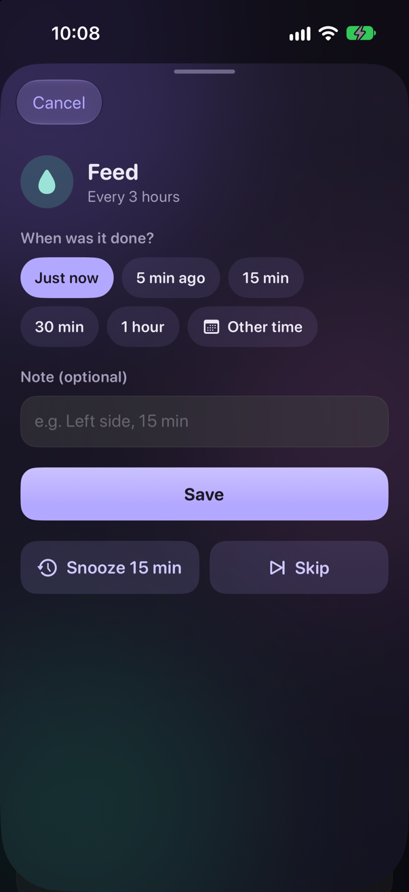 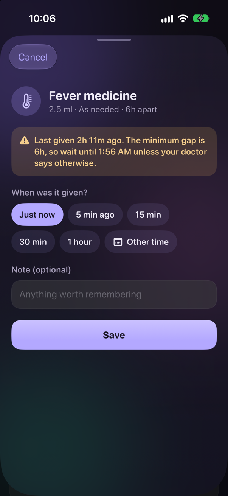</p>

Opens from a row tap, "Done earlier?", or the long-press menu. Full height.

- Header: icon badge, name, and "{dosage} · {schedule}".
- **As-needed gap warning** (amber box, only if logging too soon): "Last given 2h ago. The minimum gap is 6h, so wait until 5:06 PM unless your doctor says otherwise." It is a warning only; saving is still allowed.
- "When was it done?" (as-needed: "When was it given?") with chips **Just now** · **5 min ago** · **15 min** · **30 min** · **1 hour** · **Other time** (calendar icon). *Other time* shows a date and time wheel limited to the last 7 days.
- "Note (optional)" field. The placeholder depends on the name:
  - names containing "feed": "e.g. Left side, 15 min"
  - "diaper": "e.g. Wet and dirty"
  - "nap" or "sleep": "e.g. Slept 1h 20m"
  - anything else: "Anything worth remembering"
- **Save** (primary). Below it, for scheduled items only: **Snooze 15 min** and **Skip**.
- **Cancel** at the top left.

## 4. History

<p>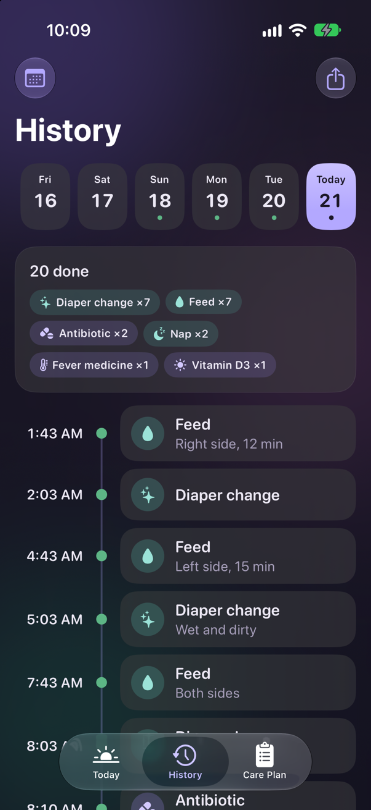</p>

- Title "History". The calendar icon (top left) opens the "Go to day" sheet with a month calendar (no future dates). The share icon (top right) opens a menu with "Share as text" and "Share as image".
- **Day strip:** horizontal chips for the last 60 days, scrolled to today. Each chip shows the weekday ("Today" for today), the date number, and a green dot if anything was logged that day. The selected chip is filled purple.
- **Day summary card** (if anything is logged): "{7} done · {1} skipped", then chips "Feed ×6", "Vitamin D3 ×1", sorted by count.
- **Timeline:** time on the left, a vertical line with dots, and a card on the right.

| Entry | Dot | Subtitle |
|---|---|---|
| Done | solid green | note · dosage (if any) |
| Skipped | grey | "Skipped" |
| Overdue (today only) | coral | "Overdue · 25 min late" (coral text) |
| Planned (today only) | hollow purple ring | "Planned" (dimmed, no card background) |

- **Past days only show what was logged.** Missed slots are never invented.
- Tapping a done or skipped entry opens **Edit entry**: item name and "Done"/"Skipped", a Time picker (done entries can't be set in the future), a Note field, and **Delete entry**, which asks "Delete this entry?" / "The next due time for {Feed} will be recalculated." **Save** is at the top right.
- Swiping left on a logged entry shows **Delete**. The toast says "Entry deleted" and offers Undo.
- Empty day: "Nothing logged" / "Things you mark as done today will appear here." (for today) or "Nothing was logged on this day."

**Share as text** example:
```
Milu's day · Tuesday, 21 Oct

✓ 8:05 AM  Feed (Left side)
✓ 9:00 AM  Vitamin D3 (1 drop)
– 11:00 AM  Diaper change — skipped

Totals: Feed ×1, Vitamin D3 ×1

Shared by Milu's Mom from Baby Care Clock
```
**Share as image:** the same content as a light-themed card, 390 pt wide at 3× scale.

## 5. Care Plan

<p>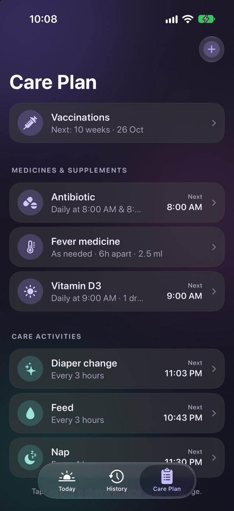</p>

- Title "Care Plan". A ⊕ button (top right) opens the Add sheet.
- First row: **Vaccinations** card. Its subtitle reads "Set up the schedule and reminders", or "Next: 10 weeks · 10 Nov", or "All vaccines given". It opens the Vaccinations page.
- Sections **MEDICINES & SUPPLEMENTS** and **CARE ACTIVITIES** are sorted A→Z. Each row shows an icon · name · "Every 3 hours · 1 drop" · on the right "Next / 2:30 PM" (not shown for as-needed items) · a bell-slash icon if reminders are off · a chevron.
- A **FINISHED** section holds ended courses, dimmed, with a green "Done" pill.
- Tapping a row opens the Edit sheet. Swiping left shows **Delete**, which asks "Delete {name}?" / "Its reminders and history will be removed too." The toast says "{name} removed" and offers Undo.
- Footer "Tap any item to change its name, times or dosage."
- Empty state: "Your care plan is empty" / "Add the feeds, naps, vitamins and medicines you want reminders for." / **Add something**.

## 6. Add / Edit item sheet

<p>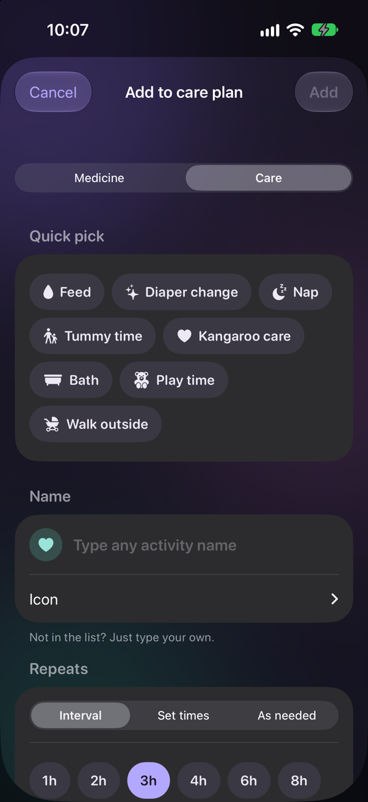 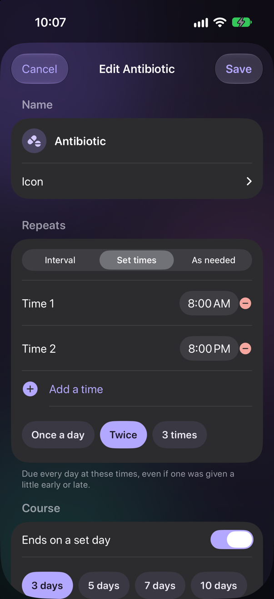 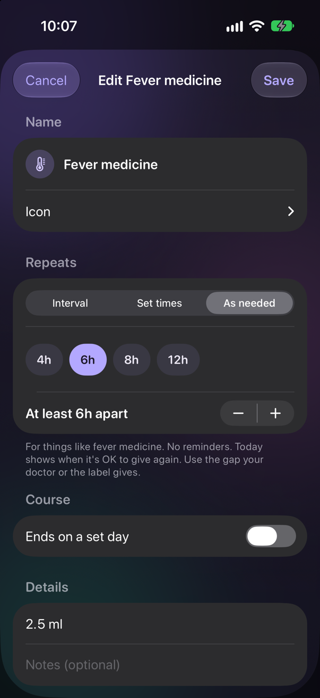</p>

Title "Add to care plan" or "Edit {name}". **Cancel** is at the top left. **Add**/**Save** is at the top right and stays disabled until there's a name.

Sections, in order:

1. **Type** (new items only): segmented control *Medicine | Care*. Changing it, while the name is empty, resets the icon and the default interval (medicine 24 h, care 3 h).
2. **Quick pick** (new items only): template chips for that type. Picking one fills in the name, icon, Interval mode and the interval.
3. **Name:** icon badge and a text field ("Type any medicine name" / "Type any activity name"). An expandable **Icon** grid offers 24 icons. Footer: "Not in the list? Just type your own."
4. **Repeats:** segmented control *Interval | Set times | As needed*.
   - **Interval:** chips 1h · 2h · 3h · 4h · 6h · 8h · 12h · Daily, plus a stepper in 15-min steps (30 min to 7 days) whose label reads like "Every 3 hours". Footer: "The next one is due this long after the last time it was done."
   - **Set times:** one time picker per time ("Time 1", "Time 2"…) with a red ⊖ to remove (when there's more than one). "⊕ Add a time" (up to 8) suggests the latest time + 4 h, capped at 11 PM. Preset chips: *Once a day* = 9:00 AM · *Twice* = 8 AM & 8 PM · *3 times* = 8 AM, 2 PM, 8 PM. Footer: "Due every day at these times, even if one was given a little early or late."
   - **As needed:** chips 4h · 6h · 8h · 12h, plus a stepper "At least 6h apart". Footer: "For things like fever medicine. No reminders. Today shows when it's OK to give again. Use the gap your doctor or the label gives."
   - Switching to As needed sets the gap to 6 h unless it's already one of the presets.
5. **Starts** (Interval only, and only while nothing has been logged for the item): *Due now | Already done | Due later*.
   - Already done → "Last done" picker (last 7 days). It logs a Done at that time.
   - Due later → "First due" picker (future only, defaults to now + interval).
6. **Course:** toggle "Ends on a set day". Chips 3 · 5 · 7 · 10 · 14 days and a "Last day" date picker. Footer: "After the last day it moves to Finished in your care plan, and its history is kept."
7. **Details:** "Dosage (e.g. 1 drop)" (medicine only; the hint comes from the matching template, otherwise "e.g. 1 drop or 2.5 ml") · "Notes (optional)" · toggle "Remind me when due" (hidden for As needed).
8. **Delete from care plan** (edit only, red).
9. Medicine footer: "Always follow your pediatrician's or pharmacist's dosing instructions. Baby Care Clock is a reminder tool, not medical advice."

Validation errors show an alert titled "Can't save yet":
- "Please enter a name."
- "\"{Feed}\" is already in your care plan. Edit the existing one instead." (the check ignores case and spaces)
- "Choose a time between 30 minutes and 7 days."
- "Add at least one time of day."

Success toast: "{name} added".

## 7. Vaccinations

<p>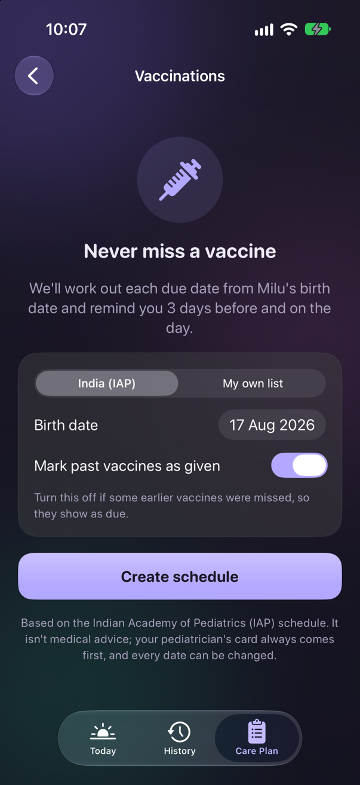 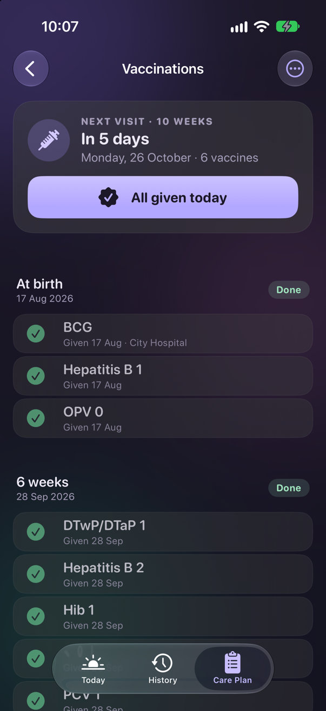</p>

Opens from Care Plan (pushed page) or the Today banner (sheet).

**Setup (no vaccines yet)**
- Syringe icon, "Never miss a vaccine", "We'll work out each due date from {name}'s birth date and remind you 3 days before and on the day."
- Card: segmented control *India (IAP) | My own list* · "Birth date" picker · (IAP only) toggle "Mark past vaccines as given" (on by default) with the hint "Turn this off if some earlier vaccines were missed, so they show as due."
- Button: **Create schedule** or **Start my own list** (the latter adds one "First vaccine" due on the birth date).
- Disclaimer: "Based on the Indian Academy of Pediatrics (IAP) schedule. It isn't medical advice; your pediatrician's card always comes first, and every date can be changed."

**List**
- **Next visit card:** "NEXT VISIT · 10 WEEKS", then "In 20 days" / "Due tomorrow" / "Due today" / "2 days overdue", then "Monday, 10 November · 6 vaccines". When it is due soon or overdue, it adds the button **All given today**, which marks all of that visit's remaining doses as given today. The toast says "10 weeks vaccines done".
- All given: "All done" / "Every vaccine on the list has been given. Wonderful!"
- One section per visit. The header shows the visit name, the date, and a status pill: *Done* (green) / *Overdue* (coral) / "In 3 days" (amber) / *Upcoming* (grey).
- Dose rows show a circle that you tap to tick (it becomes a green check mark; tapping again un-ticks), the name, and "Given 10 Nov · {note}". The toast says "Marked as given" and offers Undo.
- Tapping a row opens the **edit sheet**: Name, Due date, a "Given" toggle and "On" date, "Note (hospital, batch no.)", and **Delete vaccine**.
- Swiping left shows **Delete**.
- The ⋯ menu has "Add a vaccine" (name and due date) and "Start over", which asks "Start the vaccination list over?" / "This clears every vaccine and date you've recorded here."
- Footer: "Based on the IAP schedule. Your pediatrician may advise different timing or extra vaccines, so always follow their card. Tap a vaccine to change its date or add a note."

## 8. Settings

<p>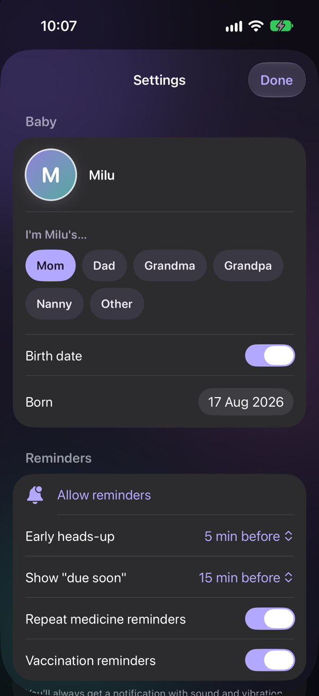</p>

Opens as a sheet from the Today gear. **Done** (top right) saves the baby fields.

1. **Baby:** avatar (tap to change the photo) · name field · "Remove photo" · the caregiver role picker · "Birth date" toggle and picker. Changing the birth date recalculates vaccine dates (see [07](07-vaccines.md)).
2. **Reminders:**
   - If notifications are denied: a red row "Notifications are off. Turn on in Settings" that opens the system settings. If permission hasn't been asked yet: "Allow reminders".
   - "Early heads-up": Off / 5 / 15 / 30 min before (**default 5**)
   - "Show \"due soon\"": 5 / 10 / 15 / 30 min before (**default 15**)
   - "Repeat medicine reminders" toggle (**default on**)
   - "Vaccination reminders" toggle (**default on**)
   - Footer: "You'll always get a notification with sound and vibration when something is due. If a medicine isn't marked done, it reminds you again 10 and 20 minutes later."
3. **Appearance:** Theme *System | Light | Dark* · Sounds *Daytime only | Always | Off*. The footer changes with the choice, e.g. "A soft chime when you tap Done or Snooze, quiet from 9 PM to 7 AM so you only feel a vibration at night. Reminder notifications are not affected."
4. **Your data:** "Export my data" (shares `BabyCareClock-backup.json`) · "Delete all data", which asks "Delete all data?" / "This removes the baby profile, photo, care plan and all history from this iPhone, including the copy kept for reinstalling. It can't be undone." and then returns to onboarding. Footer: "Everything is stored only on this iPhone. Nothing is uploaded or shared unless you choose to."
5. **About:** "Privacy & medical disclaimer" (a page with 3 cards: Your privacy, Notifications, Not medical advice) · Version.

## 9. Notifications, widgets, Watch

See [06](06-notifications.md) for notifications and [08](08-widgets-watch-shortcuts.md) for widgets, the Watch and Siri. There are no screenshots of these: the simulator needs taps on the screen (allowing notifications, adding a widget, pairing the Watch), and these couldn't be automated. They are described in words in those docs.
